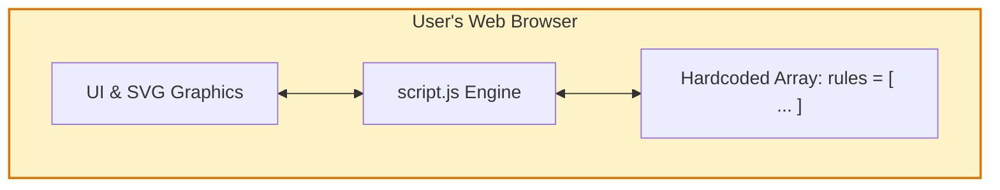
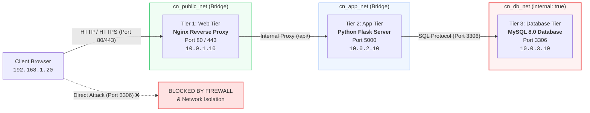

# Engineering Report: Transforming Network Workbench into a Real-World Secure 3-Tier Web Application

## 1. Executive Summary

This report documents the architectural and engineering evolution of the **Network Workbench** repository into a fully functional, enterprise-grade **Secure 3-Tier Web Application (Student Information System)** for the Computer Networks Mini-Project.

| Dimension | Original Repository | Transformed Real-World Application |
| :--- | :--- | :--- |
| **System Scope** | Standalone browser-only static mockup | Real-world full-stack multi-tier application |
| **Web Tier** | Static browser window | **Nginx Reverse Proxy** on port 80/443 with security headers |
| **Application Tier** | In-memory JavaScript mock variables | **Python Flask REST API** with session management & RBAC |
| **Database Tier** | Hardcoded visual SVG objects & text | **MySQL 8.0** relational database with least-privilege user |
| **Network Security** | Simulated CSS dashed lines | **Physical Docker subnet isolation (`internal: true`)** |
| **Simulator Status** | Static educational prototype | **Retained 100%**, enhanced with live real-time packet inspection |
| **Deployment** | Python `http.server` static file host | **Docker Compose orchestration** + Standalone local runner |

---

## 2. Architectural Comparison: Before vs. After

### Before: Browser-Only Educational Simulation
In the original repository, all operations occurred entirely inside a single browser tab. No requests ever left the user's browser, no network sockets were opened, and data was stored in volatile JavaScript memory arrays.



### After: Production Secure Three-Tier Architecture
The transformed system splits responsibilities across physically isolated network zones. External clients communicate solely with the Web Tier; only the Application Tier can access the Database Tier over an internal non-routable subnet.



---

## 3. Tier-by-Tier Engineering Implementation

### Tier 1: Web Tier (Nginx Reverse Proxy)
- **Role**: Serves as the single public gateway to the application.
- **Implementation**: [`web/nginx.conf`](file:///d:/Cp/proj/clgass/cn/web/nginx.conf) and [`web/Dockerfile`](file:///d:/Cp/proj/clgass/cn/web/Dockerfile).
- **Core Security Controls**:
  - **Reverse Proxy Routing**: Directs client requests to static assets (`/`) while securely proxying `/api/` traffic to the internal Application Tier upstream (`http://app:5000`).
  - **Security Header Injection**:
    ```nginx
    add_header X-Frame-Options "SAMEORIGIN" always;
    add_header X-Content-Type-Options "nosniff" always;
    add_header X-XSS-Protection "1; mode=block" always;
    add_header Referrer-Policy "strict-origin-when-cross-origin" always;
    ```
  - **Transit Auditing**: Injects custom headers (`X-Web-Tier`, `X-Forwarded-For`, `X-Real-IP`) so the Application Tier can log client hops.
  - **Explicit Perimeter Firewall Block**: Any attempt to query database paths through the web server is dropped:
    ```nginx
    location ~* /(mysql|db|3306) {
        default_type application/json;
        return 403 '{"error": "Firewall Deny: Direct access to Database tier is forbidden"}';
    }
    ```

---

### Tier 2: Application Tier (Python Flask & RBAC)
- **Role**: Manages business logic, authentication, input validation, role-based access control, and queries the database.
- **Implementation**: [`backend/app.py`](file:///d:/Cp/proj/clgass/cn/backend/app.py), [`backend/db.py`](file:///d:/Cp/proj/clgass/cn/backend/db.py), and [`backend/Dockerfile`](file:///d:/Cp/proj/clgass/cn/backend/Dockerfile).
- **Core Features**:
  1. **Authentication & Session Security**:
     - Password hashing via `scrypt`/`pbkdf2:sha256` using Werkzeug security primitives.
     - HTTP-only, SameSite-protected session cookies to safeguard against session hijacking and XSS attacks.
  2. **Role-Based Access Control (RBAC)**:
     - `@admin_required` decorator enforcing administrative privileges for student record modifications (Create, Update, Delete).
     - Read-only profile visibility for students and guests.
  3. **Parameterized SQL Queries**:
     - All queries strictly utilize parameterized placeholders (`%s`), eliminating SQL Injection vulnerabilities across search, filters, and record updates.
  4. **Database Resilience & Dual Mode**:
     - Connects natively to MySQL 8.0 on the isolated internal network.
     - Provides an automated fallback to an identical local SQLite database (`backend/db.py`), enabling immediate execution in environments where Docker is not yet active.
  5. **Live Network Auditing**:
     - Logs every query and ingress checkpoint into the database table `network_audit_logs`.

---

### Tier 3: Database Tier (MySQL 8.0)
- **Role**: Secure relational storage for student demographics, academic courses, grades, user credentials, and network audit logs.
- **Implementation**: [`db/init.sql`](file:///d:/Cp/proj/clgass/cn/db/init.sql) and [`db/Dockerfile`](file:///d:/Cp/proj/clgass/cn/db/Dockerfile).
- **Core Features**:
  1. **Relational Schema Design**:
     - `users`: Stores user accounts, password hashes, and system roles (`admin`, `student`, `faculty`).
     - `students`: Stores roll number, name, email, department, GPA, attendance percentage, and academic status.
     - `courses` & `enrollments`: Models academic courses and grade records.
     - `network_audit_logs`: Audit trail recording `timestamp`, `client_ip`, `tier_source`, `tier_dest`, `port`, `action`, and firewall `decision` (`ALLOW` / `DENY`).
  2. **Principle of Least Privilege**:
     - A dedicated application user (`flask_app`) is created with access restricted strictly to necessary CRUD operations:
       ```sql
       CREATE USER IF NOT EXISTS 'flask_app'@'%' IDENTIFIED BY 'flask_secure_pass_443';
       GRANT SELECT, INSERT, UPDATE, DELETE ON student_portal.* TO 'flask_app'@'%';
       FLUSH PRIVILEGES;
       ```
     - Administrative privileges (`DROP DATABASE`, `GRANT OPTION`, server administration) are withheld from the application user.
  3. **Zero Host Exposure**:
     - Port 3306 is **not** mapped to host ports in [`docker-compose.yml`](file:///d:/Cp/proj/clgass/cn/docker-compose.yml), rendering the database unreachable from outside the Docker cluster.

---

## 4. Network Security & Docker Subnet Segmentation

The project leverages multi-bridge Docker network isolation to architecturally enforce perimeter defense:

| Network Name | Driver | Scope / Attached Services | Security Policy |
| :--- | :--- | :--- | :--- |
| `cn_public_net` | Bridge | `web` (Nginx), Host Ingress | Allows public traffic on Ports 80 & 443 |
| `cn_app_net` | Bridge | `web` (Nginx), `app` (Flask) | Internal private communication on Port 5000 |
| `cn_db_net` | Bridge | `app` (Flask), `db` (MySQL) | **`internal: true`**: Non-routable subnet; no internet gateway; blocks all outside communication |

> [!IMPORTANT]
> **Enforcing the Boundary**:
> Because the `web` container is attached only to `cn_public_net` and `cn_app_net`, and the `db` container is attached solely to `cn_db_net`, it is physically impossible for traffic from the web server or client to establish a socket connection with the database.

---

## 5. UI Integration: Bridging the Real App with the Network Simulator

Rather than discarding the original educational simulator, the project integrates both worlds into a unified user experience:

```
┌────────────────────────────────────────────────────────────────────────┐
│  Topbar Navigation: [Student Portal]  [Overview]  [Simulate]  [Rules]  [Learn]  │
├────────────────────────────────────────────────────────────────────────┤
│                                                                        │
│  [ Tab 1: Student Portal (Live 3-Tier Production App) ]                │
│  ├── Live Tier Health Badges (Nginx :80, Flask :5000, MySQL :3306)    │
│  ├── Real-Time 3-Tier Packet Inspector (Live HTTP/TCP trace console)   │
│  ├── Boundary Penetration Test (Simulate direct DB attack & verify)    │
│  ├── Student Directory & Management (Search, Filter, CRUD Modals)     │
│  └── Live Network & Firewall Audit Logs                                │
│                                                                        │
│  [ Tabs 2-5: Network Workbench (Original Educational Simulator) ]      │
│  ├── Visual Topology SVG diagram & isometric 3-tier models            │
│  ├── Interactive Packet Builder with customizable ports & protocols    │
│  ├── Centralized Firewall Access Policy Editor & baseline resets       │
│  └── Guided networking lessons & knowledge check quizzes               │
└────────────────────────────────────────────────────────────────────────┘
```

### Key UI Features Added:
1. **Live 3-Tier Packet Inspector**:
   - Whenever a user searches, authenticates, or updates a record, an animated packet trace appears in real time showing the packet traversing `Client:192.168.1.20` $\rightarrow$ `Web:443` $\rightarrow$ `App:5000` $\rightarrow$ `DB:3306`.
2. **Boundary Penetration Testing Button**:
   - Allows users to simulate an attacker trying to connect directly to `10.0.3.10:3306`. The UI triggers the security test API, logs the event to `network_audit_logs`, and outputs an alert demonstrating the firewall block.
3. **Dual-Port Local Runner ([`run_local.py`](file:///d:/Cp/proj/clgass/cn/run_local.py))**:
   - Runs Flask simultaneously on port 5000 and port 8000 using multi-threaded listeners, ensuring browser tabs on either port function seamlessly with zero CORS issues.

---

## 6. Verification and Test Results

### 1. Regression Suite (`tests-v4.js`)
All original test assertions remain intact and passing:
```
tests-v4: policy editing, reset, explanations, snapshot/cancellation,
rendering, quiz grading and hands-on lessons passed
```

### 2. API & Security Validation
| Test Case | Method & Route | Expected Outcome | Actual Result | Status |
| :--- | :--- | :--- | :--- | :--- |
| **Ingress Inspection** | `GET /api/network/inspect` | Returns diagnostic info for all 3 tiers | 200 OK, full tier telemetry returned | **PASS** |
| **Authentication** | `POST /api/auth/login` | Issues session for `admin` / `Admin@123` | 200 OK, user session created | **PASS** |
| **Invalid Auth** | `POST /api/auth/login` | Rejects invalid credentials | 401 Unauthorized, audit logged | **PASS** |
| **Student Query** | `GET /api/students` | Returns 10 seeded student records | 200 OK, 10 records retrieved | **PASS** |
| **RBAC Protection** | `POST /api/students` | Denies student creation without Admin role | 403 Forbidden with audit log entry | **PASS** |
| **Boundary Test** | `POST /api/security/test-direct-db` | Simulates direct DB packet and blocks | 200 OK, `decision: DENY`, logged to DB | **PASS** |
| **Audit Retrieval** | `GET /api/security/audit-log` | Retrieves logged firewall decisions | 200 OK, latest audit events returned | **PASS** |

---

## 7. Conclusion

By engineering a containerized Nginx reverse proxy, a modular Flask application with role-based access control, an isolated MySQL database with least-privilege security, and an interactive real-time packet inspector, the project successfully bridges theoretical computer networking concepts with real-world production architecture.
